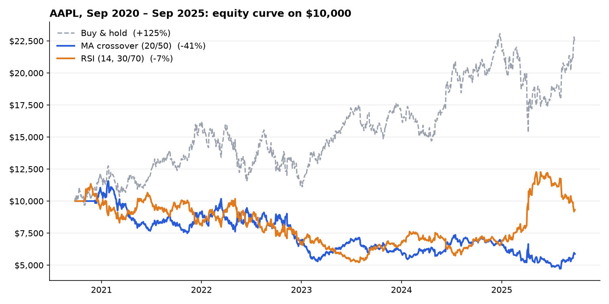

# Backtester

A desktop app for backtesting simple trading strategies on daily stock prices.
Load a price CSV, pick a strategy, and compare equity curves, total return, and
Sharpe ratio side by side.



## Results on AAPL (Sep 2020 – Sep 2025)

Starting with $10,000 on the included five years of daily AAPL prices:

| Strategy | Total return | Sharpe | Max drawdown | Final value |
|---|---:|---:|---:|---:|
| Buy & hold (benchmark) | +124.6% | 0.71 | −33.4% | $22,459 |
| MA crossover (20/50) | −41.2% | −0.24 | −59.2% | $5,876 |
| RSI (14, buy < 30, sell > 70) | −6.8% | 0.09 | −54.0% | $9,320 |

**Neither strategy beat simply holding the stock.** Both go short when their
signal turns bearish, and in a market that rose 125% over the period, the time
spent short cost far more than the time saved during drawdowns. The MA
crossover also lags: by the time the 20-day average crosses the 50-day, much
of each move has already happened.

That's the point of backtesting: finding out a rule doesn't work before you
trade it.

## Strategies

**Moving-average crossover.** Long when the short moving average is above the
long one, short when it's below. Both windows are configurable (default 20 and
50 days).

**RSI mean reversion.** Computes a 14-day Relative Strength Index. Goes long
when RSI drops below 30 (oversold), short when it rises above 70 (overbought),
and holds the last position in between.

In both cases the signal is shifted one day, so each trade uses the next day's
return and the backtest can't see the future.

## How it's measured

- **Total return:** final equity versus the $10,000 start.
- **Sharpe ratio:** mean daily return ÷ standard deviation, annualized by √252.
  Uses a 0% risk-free rate.
- **Equity curve:** compounded daily strategy returns.

**Assumptions to keep in mind:** no trading costs, slippage or borrowing fees
for shorts. Trades happen at the daily closing price, and RSI uses a simple
rolling average rather than Wilder's smoothing.

## Run it

Requires Python 3.10+ with Tkinter (included with the python.org installers on
Windows and macOS; on Debian/Ubuntu install `python3-tk`).

```bash
pip install -r requirements.txt
python backtester_v3.py
```

Click **Load CSV**, choose a file, tick one or both strategies, and click
**Run Backtest**.

### CSV format

Same layout as Investing.com's historical-data export. The app needs a `Date`
column (day first, e.g. `25/09/2025`) and a `Price` column (closing price);
other columns are ignored.

```
Date,Price,Open,High,Low,Vol.,Change %
25/09/2025,252.17,253.38,253.89,251.72,8.37M,-0.06%
```

## Tests

```bash
pytest
```

The tests check that RSI stays between 0 and 100 and that both strategies
return a return, a Sharpe ratio, and a full-length equity curve.

## Project structure

```
backtester_v3.py                    Strategy logic and Tkinter app
test_backtester.py                  Unit tests
Apple (AAPL) Historical Data.csv    Sample data, Sep 2020 – Sep 2025
docs/equity_curve.png               Chart shown above
```

## Ideas for next steps

- Add trading costs and a long-only mode, to see whether either rule holds up
  without shorting
- Report max drawdown and win rate in the app
- Test parameters on one period and evaluate on another, to avoid overfitting
